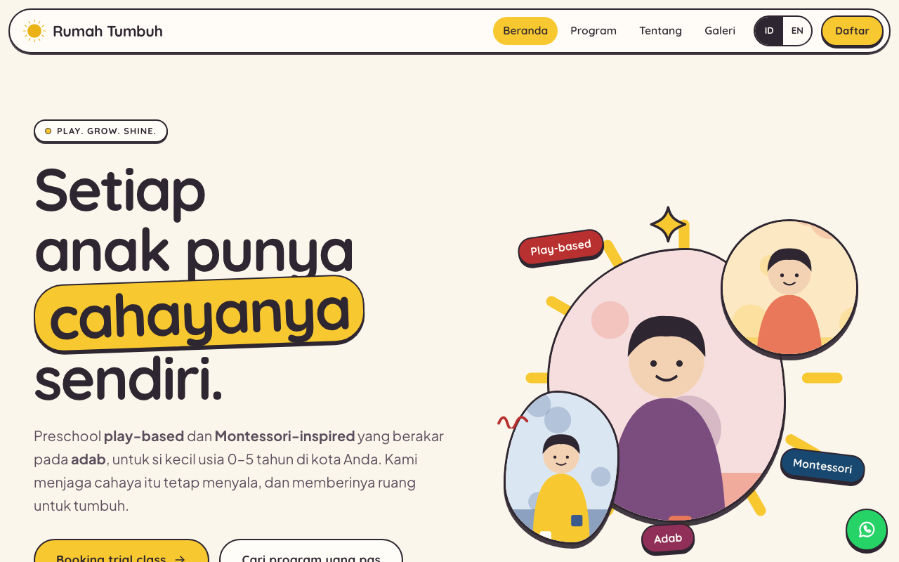

# Template Preschool Montessori

Template website premium Astro untuk preschool/daycare Montessori: 5 halaman, dua bahasa, kuis program, form daftar ke WhatsApp.

Tier: **premium** · Kategori: Template Website



## Fitur

- 5 halaman: beranda, program, tentang, galeri, daftar
- Dua bahasa ID/EN
- Data konten & kontak di src/scripts/data.js
- Kuis pencari program
- Jadwal mingguan interaktif
- Form daftar 4 langkah ke WhatsApp
- Galeri dengan lightbox
- Smooth scroll Lenis + animasi GSAP
- Transisi halaman Astro

## Cara menjalankan

1. Pasang [Node.js](https://nodejs.org) versi 18 ke atas.
2. Buka terminal di folder ini.
3. Jalankan `npm install`.
4. Jalankan `npm run dev`, buka http://localhost:4321.
5. Untuk online: `npm run build`, lalu unggah folder `dist/` ke Netlify/Vercel/GitHub Pages.

## Struktur folder

```
src/pages/       halaman (index, program, tentang, galeri, daftar)
src/layouts/     kerangka halaman, header, footer
src/scripts/data.js  kontak, program, paket, FAQ (contoh)
src/scripts/app.js   animasi & interaksi
src/styles/global.css  warna & tampilan
public/img/      ilustrasi SVG pengganti foto
meta.json, README.md, LICENSE, ss.png
```

## Cara ubah brand & warna

Kontak & tautan sosmed di `CONTACT` (`src/scripts/data.js`), program/paket/FAQ di berkas yang sama. Nama brand: cari `Rumah Tumbuh` di `src/`. Warna di `src/styles/global.css` `:root`. Ganti ilustrasi di `public/img/` dengan foto Anda.

## Kredit

Dibuat oleh Maliki Studio — malikisaputra.biz.id, follow TikTok/IG @malikisaputra

## Lisensi

MIT — lihat berkas `LICENSE`. Semua nama, kontak, dan angka di template ini **fiktif**; ilustrasi SVG buatan sendiri, silakan ganti dengan foto milik Anda.
